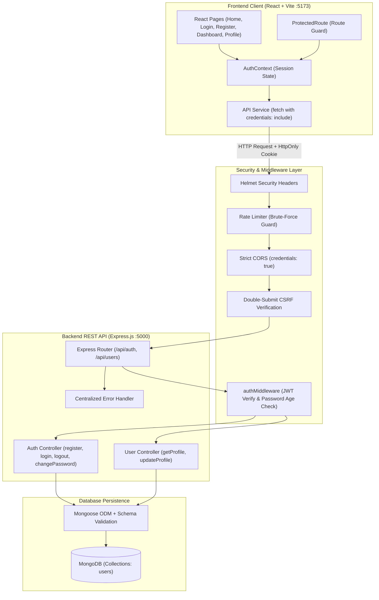

# User Authentication in React and Node.js Application

A secure full-stack user authentication and authorization system built for college Node.js laboratory demonstration and practical examination.

---

## 1. Project Overview

This project demonstrates how to implement a secure, stateless user authentication architecture using **React.js (Vite)** on the frontend, **Node.js (Express.js)** on the backend, and **MongoDB (Mongoose)** for persistence.

Unlike naive implementations that store sensitive JWT tokens in `localStorage` or `sessionStorage` (exposing them to Cross-Site Scripting [XSS] attacks), this project secures session tokens in **HttpOnly, SameSite, signed cookies**. It also incorporates **bcrypt password hashing** with 10 salt rounds, **Helmet HTTP security headers**, **IP rate limiting**, and **Double-Submit Cookie CSRF protection**.

---

## Live Demo

🌐 **Live Website:** https://user-authentication-frontend-3lwg.onrender.com

💻 **GitHub Repository:** https://github.com/257r1a66b8/user-authentication-system

## 2. Problem Statement

Modern web applications require robust mechanisms to:
1. Verify user identity without transmitting plaintext credentials across the wire after initial authentication.
2. Maintain user sessions across page reloads without exposing cryptographic tokens to client-side JavaScript.
3. Protect user accounts against credential stuffing, brute-force attacks, CSRF, and privilege escalation.
4. Provide a clear separation of concerns between client UI logic, routing guards, server API controllers, and data models.

---

## 3. Project Objectives

- Implement user registration with robust validation and duplicate detection.
- Authenticate credentials safely and issue signed JSON Web Tokens (JWT).
- Secure tokens in HttpOnly cookies inaccessible to frontend scripts.
- Guard frontend routes and backend REST endpoints against unauthorized access.
- Enable authenticated users to manage their profile name and change their password.
- Invalidate tokens or require re-authentication when passwords change.
- Provide comprehensive error handling with user-friendly feedback.
- Deliver an automated test suite verifying all critical authentication paths.

---

## 4. System Architecture



---

## 5. Authentication Workflow

```mermaid
sequenceDiagram
    autonumber
    actor User as User Browser
    participant React as React App (Client)
    participant Server as Express Server
    participant DB as MongoDB

    %% Registration Flow
    Note over User,DB: 1. Registration Flow
    User->>React: Fill Name, Email, Password
    React->>Server: POST /api/auth/register
    Server->>DB: Check if email exists
    alt Email already registered
        DB-->>Server: User document found
        Server-->>React: HTTP 409 Conflict ("Email already registered")
    else Email is new
        Server->>Server: Hash password with bcrypt (10 rounds)
        Server->>DB: Save user document
        Server->>Server: Sign JWT token
        Server-->>React: HTTP 201 Created + Set-Cookie (auth_token; HttpOnly; SameSite=Lax)
        React->>User: Redirect to Protected Dashboard
    end

    %% Login Flow
    Note over User,DB: 2. Login Flow
    User->>React: Fill Email, Password
    React->>Server: POST /api/auth/login
    Server->>DB: Find user by email
    alt Invalid user or password mismatch
        Server-->>React: HTTP 401 Unauthorized ("Invalid email or password")
    else Credentials match
        Server->>Server: Sign JWT token
        Server-->>React: HTTP 200 OK + Set-Cookie (auth_token; HttpOnly)
        React->>User: Set user state & navigate to /dashboard
    end

    %% Protected Session Verification
    Note over User,DB: 3. Session Persistence (Page Reload)
    User->>React: Refresh Page (F5)
    React->>Server: GET /api/auth/me (Cookie sent automatically)
    Server->>Server: Verify JWT signature & expiration
    Server->>DB: Find user by ID & check passwordChangedAt
    Server-->>React: HTTP 200 OK + safe user profile
    React->>User: Render Dashboard seamlessly
```

---

## 6. Technology Stack

| Layer | Technology | Version | Purpose |
| :--- | :--- | :--- | :--- |
| **Frontend Framework** | React.js | `^18.3.1` | Declarative component UI |
| **Bundler & Dev Server**| Vite | `^5.4.0` | High-speed build tooling & HMR |
| **Routing** | React Router DOM | `^6.26.0` | Client-side routing and protected routes |
| **Styling** | Modern CSS3 | Standard | Responsive CSS with variables & resets |
| **Backend Framework** | Node.js / Express.js | `^4.19.2` | REST API server (ES modules) |
| **Database ODM** | Mongoose | `^8.5.1` | MongoDB document modeling & validation |
| **Password Hashing** | bcryptjs | `^2.4.3` | One-way hashing with salt rounds |
| **Token Signing** | jsonwebtoken | `^9.0.2` | Cryptographic JWT creation & verification |
| **Cookie Parsing** | cookie-parser | `^1.4.6` | Parsing HttpOnly session cookies |
| **Security Headers** | Helmet | `^7.1.0` | Setting standard secure HTTP headers |
| **Rate Limiter** | express-rate-limit | `^7.3.1` | Brute-force attack mitigation |
| **CORS** | cors | `^2.8.5` | Origin validation with credentials support |
| **Testing** | Node.js Test Runner + Supertest | Node 20+ | Automated integration testing |

---

## 7. Database Design

### User Model (`server/models/User.js`)

| Field | Type | Required | Constraints / Defaults | Description |
| :--- | :--- | :--- | :--- | :--- |
| `name` | `String` | Yes | Trimmed, 2 to 50 characters | User's full name |
| `email` | `String` | Yes | Unique index, lowercase, email regex | Normalized login identity |
| `password` | `String` | Yes | Min 8 chars, `select: false` | 60-character bcrypt hash |
| `role` | `String` | No | Default: `'user'`, Enum: `['user', 'admin']` | Authorization access level |
| `passwordChangedAt` | `Date` | No | Updated on password changes | Used to invalidate prior JWTs |
| `createdAt` | `Date` | Auto | Managed by `timestamps: true` | Account creation timestamp |
| `updatedAt` | `Date` | Auto | Managed by `timestamps: true` | Last modification timestamp |

---

## 8. REST API Endpoints

### Authentication Endpoints (`/api/auth`)

| Method | Endpoint | Access | Rate Limited | Description |
| :--- | :--- | :--- | :--- | :--- |
| `GET` | `/api/auth/csrf-token` | Public | No | Issues a double-submit CSRF token |
| `POST` | `/api/auth/register` | Public | Yes (25/15m) | Registers user & issues HttpOnly cookie |
| `POST` | `/api/auth/login` | Public | Yes (25/15m) | Verifies credentials & sets session cookie |
| `POST` | `/api/auth/logout` | Authenticated | No | Clears the session cookie |
| `GET` | `/api/auth/me` | Protected | No | Returns profile of currently authenticated user |
| `POST` | `/api/auth/change-password` | Protected | Yes (25/15m) | Verifies current pwd and hashes new password |

### User Profile Endpoints (`/api/users`)

| Method | Endpoint | Access | Protection | Description |
| :--- | :--- | :--- | :--- | :--- |
| `GET` | `/api/users/profile` | Protected | JWT Cookie | Returns user profile details |
| `PATCH`| `/api/users/profile` | Protected | JWT + CSRF | Updates allowed fields (`name` only) |

### System Health Endpoint

| Method | Endpoint | Access | Description |
| :--- | :--- | :--- | :--- |
| `GET` | `/api/health` | Public | Checks API uptime and MongoDB connection state |

---

## 9. Folder Structure

```text
user-authentication/
├── client/                     # Frontend React (Vite) Application
│   ├── public/
│   ├── src/
│   │   ├── components/
│   │   │   ├── Loading.jsx     # Accessible loading spinner
│   │   │   ├── Navbar.jsx      # Top navigation with auth awareness
│   │   │   └── ProtectedRoute.jsx # Route guard for private pages
│   │   ├── context/
│   │   │   └── AuthContext.jsx # React context for authentication state
│   │   ├── pages/
│   │   │   ├── ChangePassword.jsx # Password update page
│   │   │   ├── Dashboard.jsx   # Protected main user dashboard
│   │   │   ├── Home.jsx        # Landing page with health indicator
│   │   │   ├── Login.jsx       # Sign in page
│   │   │   ├── NotFound.jsx    # 404 handler
│   │   │   ├── Profile.jsx     # Profile view and update
│   │   │   └── Register.jsx    # Account registration page
│   │   ├── services/
│   │   │   └── api.js          # API client with credentials & CSRF
│   │   ├── styles/
│   │   │   ├── auth.css        # Styles for auth cards and forms
│   │   │   ├── dashboard.css   # Styles for dashboard & settings
│   │   │   └── global.css      # Design tokens, reset, typography
│   │   ├── App.jsx             # React routing setup
│   │   └── main.jsx            # React root mount
│   ├── .env.example            # Client env template
│   ├── index.html              # HTML5 root with Inter font
│   ├── package.json            # Client dependencies
│   └── vite.config.js          # Vite config with backend proxy
├── server/                     # Backend Express.js REST API
│   ├── config/
│   │   ├── db.js               # MongoDB connection manager
│   │   └── seed.js             # Optional demo user seeder
│   ├── controllers/
│   │   ├── authController.js   # Register, login, logout, password logic
│   │   └── userController.js   # Profile read and update logic
│   ├── middleware/
│   │   ├── authMiddleware.js   # JWT verification and route protection
│   │   ├── csrfMiddleware.js   # Double-submit cookie CSRF guard
│   │   └── errorMiddleware.js  # 404 & centralized error handling
│   ├── models/
│   │   └── User.js             # Mongoose schema with bcrypt hooks
│   ├── routes/
│   │   ├── authRoutes.js       # Auth endpoint routes & rate limiting
│   │   └── userRoutes.js       # User profile routes
│   ├── tests/
│   │   └── auth.test.js        # 12 automated integration tests
│   ├── utils/
│   │   └── token.js            # JWT signing and cookie utilities
│   ├── .env.example            # Server env template
│   ├── package.json            # Server dependencies
│   └── server.js               # Express application entrypoint
├── .gitignore                  # Git ignore rules
├── LAB_NOTES.md                # Comprehensive college lab submission notes
├── README.md                   # This master documentation file
└── VIVA_QUESTIONS.md           # 25+ Viva examination questions and answers
```

---

## 10. Installation and Execution Guide

### Prerequisites
1. **Node.js**: Version 18.x or 20.x+ (Node 20.18 LTS is pre-configured in this repository).
2. **MongoDB**:
   - Either **MongoDB Community Server** installed locally (running on `mongodb://127.0.0.1:27017`),
   - Or a free **MongoDB Atlas cloud cluster** URI.
   *(Note: The automated test suite includes an in-memory database and runs offline without any external MongoDB installation!)*

---

### Step-by-Step Setup

#### Step 1: Backend Configuration
Open a terminal in `user-authentication/server`:
```bash
cd user-authentication/server
npm install
```

Configure your environment variables:
```bash
# On Windows PowerShell:
Copy-Item .env.example .env

# On Linux / macOS:
cp .env.example .env
```

Verify `server/.env`:
```env
PORT=5000
NODE_ENV=development
MONGODB_URI=mongodb://127.0.0.1:27017/auth_lab_db
JWT_SECRET=college_lab_jwt_super_secure_secret_key_2026_demo
JWT_EXPIRES_IN=1d
FRONTEND_URL=http://localhost:5173
COOKIE_NAME=auth_token
COOKIE_MAX_AGE_MS=86400000
```

#### Step 2: Frontend Configuration
Open a second terminal in `user-authentication/client`:
```bash
cd user-authentication/client
npm install
```

Configure frontend environment variables:
```bash
# On Windows PowerShell:
Copy-Item .env.example .env

# On Linux / macOS:
cp .env.example .env
```

`client/.env` contains:
```env
VITE_API_URL=http://localhost:5000/api
```

---

### Starting the Servers

#### Terminal 1 — Start the Backend Server:
```bash
cd user-authentication/server
npm run dev
```
*Expected Output:*
```text
🚀 Authentication Server running in [development] mode
📡 URL: http://localhost:5000
🩺 Health check: http://localhost:5000/api/health
🌐 Allowed Frontend: http://localhost:5173
[MongoDB Connected]: Host -> 127.0.0.1, Database -> auth_lab_db
```

#### Terminal 2 — Start the Frontend Client:
```bash
cd user-authentication/client
npm run dev
```
*Expected Output:*
```text
  VITE v5.4.x  ready in 250 ms

  ➜  Local:   http://localhost:5173/
  ➜  Network: use --host to expose
```

Open **`http://localhost:5173`** in your browser.

---

## 11. Automated Testing

The project includes 12 automated integration tests running against an isolated in-memory MongoDB server:

```bash
cd user-authentication/server
npm test
```

### Verified Test Results:
```text
✔ GET /api/health should return ok status and database status
✔ POST /api/auth/register should successfully register a new user and return Set-Cookie
✔ Registration must hash passwords with bcrypt in the database (no plaintext)
✔ POST /api/auth/register should reject duplicate email registrations with HTTP 409
✔ POST /api/auth/register should reject invalid registration payloads with HTTP 400
✔ POST /api/auth/login should authenticate valid credentials and issue cookie
✔ POST /api/auth/login should reject incorrect credentials with generic HTTP 401
✔ GET /api/auth/me should reject requests without authentication cookie (HTTP 401)
✔ GET /api/auth/me should return authenticated profile when valid cookie is provided
✔ POST /api/auth/logout should clear the session cookie
✔ PATCH /api/users/profile should allow updating name and block unauthorized role changes
✔ POST /api/auth/change-password should verify current password and hash new password

# tests 12 | pass 12 | fail 0 | cancelled 0
```

---

## 12. Security Implementation Details

1. **HttpOnly Cookies**: Protects JWT tokens from `document.cookie` inspection by malicious third-party scripts (XSS).
2. **Bcrypt Work Factor**: 10 salt rounds make offline dictionary attacks computationally prohibitive.
3. **Double-Submit CSRF Defense**: Requires state-changing mutations to include an `x-csrf-token` header matching the issued token.
4. **Brute-Force Rate Limiting**: Restricts authentication routes to 25 attempts per 15 minutes per IP address.
5. **Token Invalidation on Password Change**: The `User.passwordChangedAt` timestamp invalidates tokens generated prior to a password modification.
6. **Information Disclosure Prevention**: Generic authentication failure messages ("Invalid email or password") prevent account enumeration.
7. **Strict CORS**: Restricts access explicitly to `http://localhost:5173` with credentials enabled; never allows wildcards (`*`).

---

## 13. Common Troubleshooting

| Issue | Cause | Solution |
| :--- | :--- | :--- |
| **MongoDB connection fails** | Local MongoDB service is stopped | Start service via `net start MongoDB` or paste an Atlas URI into `server/.env`. |
| **CORS error in browser** | Frontend origin mismatch | Ensure `FRONTEND_URL` in `server/.env` matches `http://localhost:5173`. |
| **Cookies not sent on refresh** | Missing `credentials: 'include'` | Verified in `services/api.js`. Ensure backend CORS has `credentials: true`. |
| **Port 5000 in use** | Another service occupies port | Change `PORT=5001` in `server/.env` and update `VITE_API_URL` in `client/.env`. |
